<!-- Generated by scripts/build.py. Edit CONTENT there, not this file. -->
<a href="https://mujahidk.com">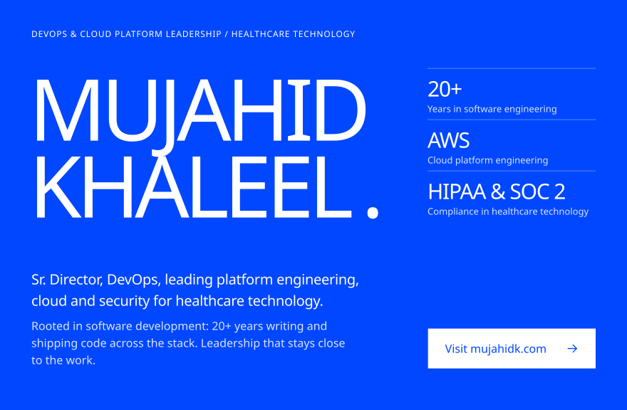</a>

<picture><source media="(prefers-color-scheme: dark)" srcset="assets/mission-dark.svg">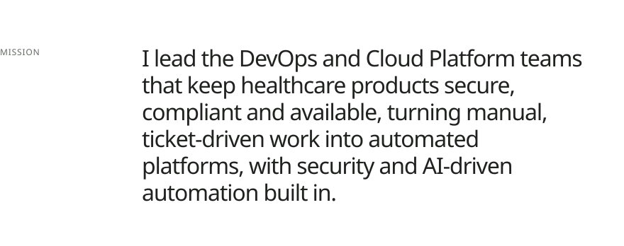</picture>
<picture><source media="(prefers-color-scheme: dark)" srcset="assets/stack-dark.svg">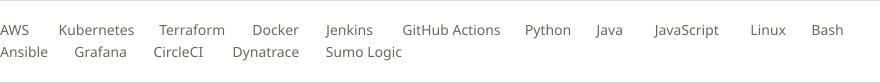</picture>

<picture><source media="(prefers-color-scheme: dark)" srcset="assets/title-focus-dark.svg"></picture>
<a href="https://mujahidk.com/cloud/"><picture><source media="(prefers-color-scheme: dark)" srcset="assets/focus-cloud-dark.svg">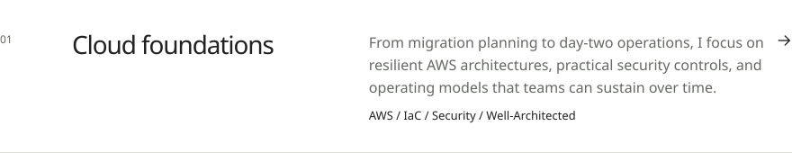</picture></a>
<a href="https://mujahidk.com/programming/"><picture><source media="(prefers-color-scheme: dark)" srcset="assets/focus-programming-dark.svg">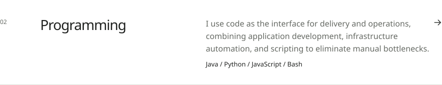</picture></a>
<a href="https://mujahidk.com/cicd/"><picture><source media="(prefers-color-scheme: dark)" srcset="assets/focus-cicd-dark.svg">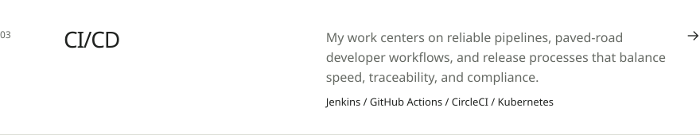</picture></a>

<a href="https://mujahidk.com/case-studies/"><picture><source media="(prefers-color-scheme: dark)" srcset="assets/title-cases-dark.svg"></picture></a>
<a href="https://mujahidk.com/case-studies/liquibase-introduction/"><picture><source media="(prefers-color-scheme: dark)" srcset="assets/case-liquibase-dark.svg">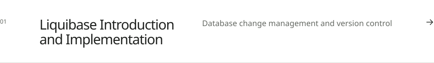</picture></a>
<a href="https://mujahidk.com/case-studies/logging-and-observability/"><picture><source media="(prefers-color-scheme: dark)" srcset="assets/case-logging-dark.svg">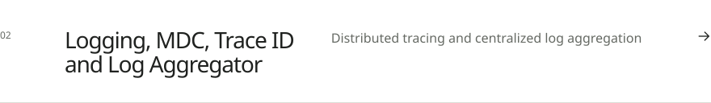</picture></a>
<a href="https://mujahidk.com/case-studies/vendor-api-simulator/"><picture><source media="(prefers-color-scheme: dark)" srcset="assets/case-vendor-api-dark.svg">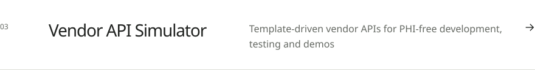</picture></a>

 

<a href="https://mujahidk.com/contact/"><picture><source media="(prefers-color-scheme: dark)" srcset="assets/closing-dark.svg">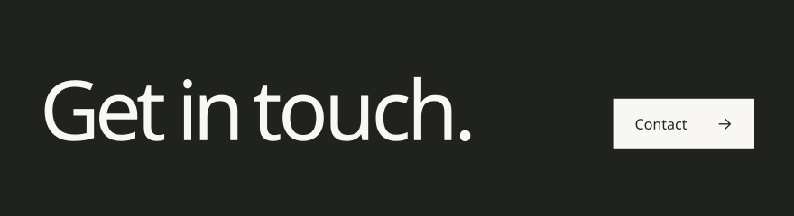</picture></a>

<picture><source media="(prefers-color-scheme: dark)" srcset="assets/sign-off-dark.svg">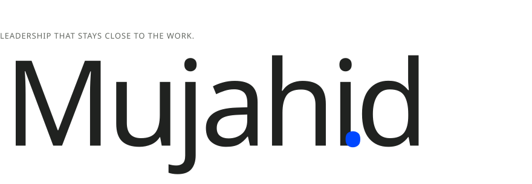</picture>

  <a href="mailto:mail@mujahidk.com">mail@mujahidk.com</a> &nbsp;&middot;&nbsp;
  <a href="https://mujahidk.com">mujahidk.com</a> &nbsp;&middot;&nbsp;
  <a href="https://www.linkedin.com/in/mujahidkhaleel">LinkedIn</a> &nbsp;&middot;&nbsp;
  <a href="https://x.com/mujahidkhaleel">X</a> &nbsp;&middot;&nbsp;
  <a href="https://mujahidk.com/feed.xml">RSS</a>

Opinions expressed are solely my own and do not express the views or opinions of my employer.
